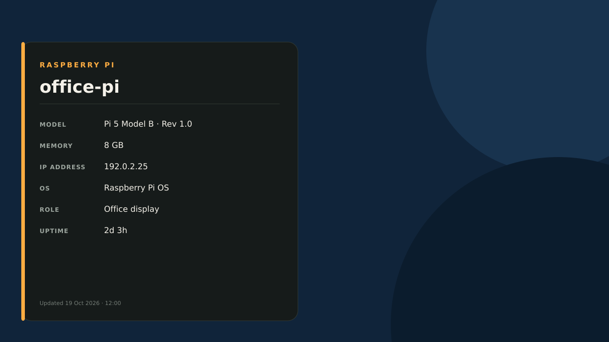

# Pi Info Wallpaper

A lightweight, dependency-free system-information wallpaper for Raspberry Pi OS
and Linux desktops. It generates a clean SVG showing the machine's hostname,
model, memory, IPv4 address, operating system, role and uptime.



## Features

- Python standard library only—no graphics packages or root access required.
- Crisp SVG output at any resolution.
- Four panel positions with configurable background and accent colours.
- Atomic updates, so the desktop never reads a half-written wallpaper.
- Automatic refresh with a user-level systemd timer.
- Wallpaper setters for PCManFM, PCManFM-Qt, XFCE and GNOME.
- Generator-only mode for unsupported desktops or custom integrations.
- Local, web-pull, SSH and inventory-based multi-Pi installation.

## Quick install

Run this as the desktop user who should own the wallpaper:

```bash
curl -fsSL https://raw.githubusercontent.com/snuffsprojects/pi-info-wallpaper/main/install-from-web.sh \
  -o /tmp/install-pi-info-wallpaper.sh
bash /tmp/install-pi-info-wallpaper.sh --role "Kitchen display" --colour '#10243a'
```

For a reproducible installation, set `PI_WALLPAPER_VERSION` to a release tag:

```bash
PI_WALLPAPER_VERSION=v1.0.0 bash /tmp/install-pi-info-wallpaper.sh --role "Kitchen display"
```

## Local installation

```bash
git clone https://github.com/snuffsprojects/pi-info-wallpaper.git
cd pi-info-wallpaper
./install.sh --role "Home server" --colour '#10243a' \
  --accent '#ffad42' --position bottom-left
```

Options:

| Option | Default | Description |
|---|---|---|
| `--role NAME` | `Raspberry Pi` | Friendly purpose shown on the panel |
| `--colour '#RRGGBB'` | `#000000` | Wallpaper background colour |
| `--accent '#RRGGBB'` | `#ffad42` | Panel accent colour |
| `--position POSITION` | `bottom-left` | `top-left`, `top-right`, `bottom-left` or `bottom-right` |
| `--width PX` | `1920` | SVG width, from 640 to 7680 |
| `--height PX` | `1080` | SVG height, from 480 to 4320 |
| `--generate-only` | off | Generate the SVG without trying to set the desktop wallpaper |

The installer copies files below `~/.local` and `~/.config`, then enables a
user-level systemd timer that refreshes the wallpaper every 15 minutes. If the
desktop is unavailable during installation, the timer retries after login.

## Change the configuration

Edit `~/.config/pi-wallpaper/config`, then run:

```bash
~/.local/bin/pi-wallpaper-refresh
```

## Deploy over SSH

```bash
./deploy.sh pi@office-pi.local --role "Office display" --colour '#10243a'
```

For several Pis, copy `inventory.example.csv` to `inventory.csv`, edit it, and run:

```bash
./deploy-all.sh inventory.csv
```

The CSV columns are `host,user,role,colour`. Never place passwords in the inventory;
use SSH keys or the normal interactive SSH prompt.

## Use a different download host

The pull installer defaults to this GitHub repository. Mirrors and private web
servers can override it:

```bash
PI_WALLPAPER_BASE_URL=https://example.net/pi-info-wallpaper \
  bash install-from-web.sh --role "Lab display"
```

## Uninstall

```bash
~/.local/bin/pi-info-wallpaper-uninstall
```

The script removes the timer, installed program and configuration. Your desktop
may continue showing the last SVG until you select another wallpaper.

## Development

```bash
python3 -m unittest discover -v
bash -n install.sh install-from-web.sh deploy.sh deploy-all.sh \
  pi-wallpaper-refresh uninstall.sh
```

See [CONTRIBUTING.md](CONTRIBUTING.md) for the contribution workflow.

## Privacy

The project makes no network requests while generating a wallpaper. The UDP
socket used to select the primary IPv4 address does not transmit a packet. Be
aware that the generated SVG visibly contains the device hostname and IP address.

## Licence

Released under the [MIT License](LICENSE).
